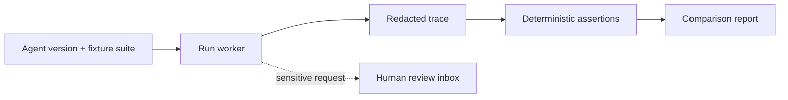

# AgentLedger

**Evaluation and governance for AI agents.** AgentLedger runs the same evaluation suite against two versions of an agent and shows the exact trace, assertion and tool decision behind every regression.

> **Status:** early development, following a 12-week roadmap (see below). The core demo runs on synthetic fixtures and needs no paid model API key.

## The problem

A faster agent isn't necessarily a better one. When a team ships a new agent version, they need to know:

- which test cases got worse, and why
- which step or tool call caused the failure
- whether a sensitive action was attempted without review
- whether a run stayed within its budget

AgentLedger answers these with recorded traces, repeatable assertions and side-by-side version comparisons.

## Demo workflow

1. Run two fictional support-agent versions on the same 20 cases
2. See that the faster version fails three policy assertions
3. Drill into the failing tool step in the trace
4. Find a sensitive mock action paused, waiting for human approval

## Planned features

- Versioned agents, runs, steps and evaluation results
- Trace waterfall with redacted inputs and outputs, step durations and failures
- Repeatable fixture-based assertions for schemas, expected values, citations and tool policy
- Version comparison and a regression view
- Honest labeling of fixture-based timing and estimated cost
- Human review inbox for sensitive mock tool requests, with an audit trail
- Run budgets, timeouts and bounded retries

## Tech stack

| Layer | Technology |
|---|---|
| Frontend | Next.js, TypeScript |
| API | Fastify |
| Database | PostgreSQL, Prisma |
| Queue | Redis, BullMQ |
| Validation | Zod |
| Testing | Vitest, Playwright |
| Observability | OpenTelemetry (optional) |

## Architecture

**Core entities:** Workspace, AgentDefinition, AgentVersion, AgentRun, AgentStep, ToolInvocation, EvaluationSuite, EvaluationCase, AssertionResult, ApprovalRequest, AuditEntry.

## Design rules

- Agent versions are immutable, and every run links to exactly one version.
- Sensitive inputs and outputs are redacted before they are stored.
- Trace content is untrusted and can never authorize an action.
- Sensitive actions stay paused until an authorized person decides.
- Over-budget runs stop and report why.
- Workspaces are fully isolated from each other.

## Roadmap

| Weeks | Focus |
|---|---|
| 1–2 | Web, API and worker workspace with CI; roles, immutable agent versions, run storage |
| 3–4 | Trace events, redaction and persistence; run detail APIs and trace waterfall |
| 5–6 | Evaluation suites, fixture runner and assertions; version comparison and regressions |
| 7–8 | Review inbox and audit trail for sensitive requests; budgets and bounded retries |
| 9–10 | Security testing (untrusted trace text, isolation, redaction); instrumentation |
| 11–12 | Release images, end-to-end tests, API docs and a reproducible demo |

## Getting started

Setup instructions will be added once the first packages are in place.
