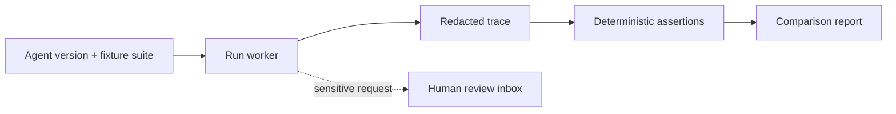

# AgentLedger

**Evaluation and governance for AI agents.** AgentLedger runs the same evaluation suite against two versions of an agent and shows the exact trace, assertion and tool decision behind every regression.

> **Status:** early development, following a 6-week roadmap (see below). The core demo runs on synthetic fixtures and needs no paid model API key.

## The problem

A faster agent isn't necessarily a better one. When a team ships a new agent version, they need to know:

- which test cases got worse, and why
- which step or tool call caused the failure
- whether a sensitive action was attempted without review
- whether a run stayed within its budget

AgentLedger answers these with recorded traces, repeatable assertions and side-by-side version comparisons.

## Demo workflow

1. Run two fictional support-agent versions on the same 20 cases
2. See that the faster version fails three policy assertions
3. Drill into the failing tool step in the trace
4. Find a sensitive mock action paused, waiting for human approval

## Planned features

- Versioned agents, runs, steps and evaluation results
- Trace waterfall with redacted inputs and outputs, step durations and failures
- Repeatable fixture-based assertions for schemas, expected values, citations and tool policy
- Version comparison and a regression view
- Honest labeling of fixture-based timing and estimated cost
- Human review inbox for sensitive mock tool requests, with an audit trail
- Run budgets, timeouts and bounded retries

## Tech stack

| Layer | Technology |
|---|---|
| Frontend | Next.js, TypeScript |
| API | Fastify |
| Database | PostgreSQL, Prisma |
| Queue | Redis, BullMQ |
| Validation | Zod |
| Testing | Vitest, Playwright |
| Observability | OpenTelemetry (optional) |

## Architecture



**Core entities:** Workspace, AgentDefinition, AgentVersion, AgentRun, AgentStep, ToolInvocation, EvaluationSuite, EvaluationCase, AssertionResult, ApprovalRequest, AuditEntry.

## Design rules

- Agent versions are immutable, and every run links to exactly one version.
- Sensitive inputs and outputs are redacted before they are stored.
- Trace content is untrusted and can never authorize an action.
- Sensitive actions stay paused until an authorized person decides.
- Over-budget runs stop and report why.
- Workspaces are fully isolated from each other.

## Roadmap

| Week | Focus | Status |
|---|---|---|
| Week 1 | **W01-01 + CI** — Scaffold pnpm workspace with web, api and worker packages, add shared run contract with valid and invalid fixture tests, add Compose stack for PostgreSQL and Redis | ✅ Done |
| Week 2 | **Runs & traces** — Add Fastify API with Prisma schema for workspaces and roles, add immutable agent versions, store runs linked to versions, add trace events with redaction | ✅ Done |
| Week 3 | **Run views** — Add run detail and trace endpoints, add run list, add trace waterfall | Planned |
| Week 4 | **Evaluations** — Add evaluation suites and assertions, add fixture runner, compare agent versions, add regression view | Planned |
| Week 5 | **Safety & limits** — Pause sensitive mock actions for approval, add review inbox and audit trail, enforce budgets and bounded retries | Planned |
| Week 6 | **Release** — Instrument API and worker with OpenTelemetry, add recovery guide and provider settings, add release images, add end-to-end tests and API docs | Planned |

## Getting started

Local PostgreSQL and Redis run with Docker Compose:

```bash
cp .env.example .env        # then set POSTGRES_PASSWORD
docker compose up -d
```

See [`infra/README.md`](infra/README.md) for details.

### API

```bash
pnpm install                              # also generates the Prisma client
pnpm --filter @agentledger/contracts build
pnpm --filter @agentledger/api db:deploy  # apply migrations to DATABASE_URL
pnpm --filter @agentledger/api db:seed    # synthetic workspaces; prints local API tokens
pnpm --filter @agentledger/api dev        # http://localhost:4000
```

Requests use `Authorization: Bearer <token>`. Workspace roles, from least to most privileged: `viewer`, `reviewer`, `editor`, `admin`. A workspace you are not a member of answers `404`, exactly like one that does not exist.

| Method | Path | Role |
|---|---|---|
| `GET` | `/health` | public |
| `GET` | `/v1/workspaces` | any signed-in user (lists own workspaces) |
| `POST` | `/v1/workspaces` | any signed-in user (becomes `admin`) |
| `GET` | `/v1/workspaces/:workspaceId` | `viewer` |
| `GET` | `/v1/workspaces/:workspaceId/members` | `admin` |
| `GET` | `/v1/workspaces/:workspaceId/agents` | `viewer` |
| `POST` | `/v1/workspaces/:workspaceId/agents` | `editor` |
| `GET` | `/v1/workspaces/:workspaceId/agents/:agentId` | `viewer` |
| `GET` | `/v1/workspaces/:workspaceId/agents/:agentId/versions` | `viewer` (newest first, without config) |
| `POST` | `/v1/workspaces/:workspaceId/agents/:agentId/versions` | `editor` |
| `GET` | `/v1/workspaces/:workspaceId/agents/:agentId/versions/:version` | `viewer` (full config) |
| `POST` | `/v1/workspaces/:workspaceId/runs` | `editor` |
| `GET` | `/v1/workspaces/:workspaceId/runs` | `viewer` (newest first; `agentId`, `status`, `limit` ≤ 100, `cursor`) |
| `GET` | `/v1/workspaces/:workspaceId/runs/:runId` | `viewer` (with input) |
| `POST` | `/v1/workspaces/:workspaceId/runs/:runId/cancel` | `editor` |
| `POST` | `/v1/workspaces/:workspaceId/runs/:runId/trace-events` | `editor` (up to 100 events per request) |

Errors share one shape: `{ "error": { "code": "...", "message": "...", "details"?: ... } }`.

**Agent versions are immutable.** Publishing a config (model, instructions, tools, budget — validated by `AgentVersionConfigSchema` in `@agentledger/contracts`) stores it as the next version number. A version can never be edited or deleted: the API answers `PUT`/`PATCH`/`DELETE` with `405 version_immutable`, and a database trigger rejects `UPDATE` and `DELETE` on `agent_versions`. Each version stores a SHA-256 `configHash` of its key-sorted JSON; publishing a config identical to the latest version returns `409 version_unchanged`. Send `expectedLatestVersion` (or `null` for the first version) to get `409 version_conflict` instead of silently publishing on top of someone else's change. The seed adds a demo `refund-assistant` agent with two versions in `acme-support`.

**Runs stay linked to one version.** `POST …/runs` with `{ "agentId", "version"?, "input" }` queues a run on that version (default: the latest) and copies its budget onto the run; `input` is a JSON object of at most 32 KB. Runs of `fixture` models are labelled `timingSource: "fixture"` so replayed timings are never shown as measurements. Responses carry the run in the shared contract shape (`run`, with `steps` filled in once traces are recorded), plus `lifecycle` (`createdById`, `startedAt`, `failureReason`). Status changes follow the contract's `RUN_STATUS_TRANSITIONS`; an invalid move, such as cancelling a finished run, answers `409 invalid_run_transition`. In PostgreSQL a composite foreign key keeps each run, its agent and its version in one workspace, CHECK constraints tie `startedAt`/`finishedAt`/`failureReason` to the status, and a trigger rejects deleting a run or changing anything but its status fields. Runs of other workspaces answer `404 run_not_found`.

**Traces are redacted before they are stored.** A worker reports each step attempt as a `step_started` event (index, kind, name, tool, input) and a `step_finished` event (status, output or error), numbered per run from `sequence` 0; event and step IDs come from the worker, so replaying a fixture gives the same IDs. The API redacts input, output and error text with the contract's rules (secret and personal field names, plus emails, API keys and bearer tokens, Luhn-valid card numbers and international phone numbers inside text) and stores only the redacted copy, with a `redactions` list of the paths that were removed. Re-sending stored events is a no-op (`200`, counted as `replayed`), so batches can be retried; a stored sequence with different content answers `409 trace_event_conflict` and a skipped sequence `409 trace_sequence_gap` (both with `details.nextSequence`). Events that break the step rules — index order, one start and one finish per attempt, retries only after a failed attempt, the run's step/retry/duration budget — answer `422 invalid_trace` with the issues, and only `running` or `paused` runs take new events (`409 run_not_accepting_trace`). In PostgreSQL, `trace_events` is keyed by run and sequence, tied to the run's workspace by a composite foreign key, and a trigger rejects `UPDATE`, `DELETE` and inserts into runs that are not running or paused.

**An eight-step fixture replays with stable IDs.** `loadTraceFixture` (`apps/api/src/traces/fixture.ts`) replays a trace fixture from `@agentledger/contracts` into an existing run: it checks the trace against the run's budget first, starts a queued run, appends the redacted events through the trace store and moves the run to the status the trace ends in (succeeded, failed or paused). Loading it again is a no-op. The seed uses it to add `run_acmerefund8steps`, a finished `refund-assistant` v1 run replayed from `refund-eight-steps` (18 events, IDs `evt_refund8e00`…`evt_refund8e17`, labelled `timingSource: "fixture"`); the fixture's fictional contact details and credentials are stored only as `[REDACTED:…]` markers.

Checks (the same ones CI runs on every push to `main` and every pull request):

```bash
pnpm install
pnpm lint
pnpm typecheck
pnpm test
pnpm build
```
